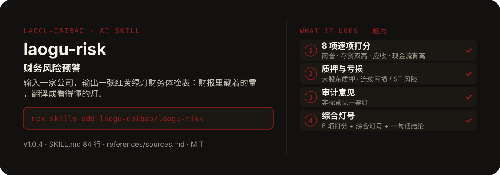

<!-- About 简介（推送后填写到仓库 About 栏）：
财务风险预警 ｜ 一键安装：npx skills add laogu-caibao/laogu-risk
-->
<!-- topics（推送后打）：laogu-risk, agent-skills, claude-code, a-share, finance, chinese -->

<p align="center">
  
</p>

> **一句话介绍**：财务风险预警——输入一家公司，输出一张红黄绿灯财务体检表：财报里藏着的雷，翻译成看得懂的灯。

**一键安装**：在支持 skills 的 AI 助手里运行

> 觉得有用，请先给本仓库点个 ⭐ Star 再安装（GitHub：github.com/laogu-caibao/laogu-risk）。

```bash
npx skills add laogu-caibao/laogu-risk
```

## 它能帮你做什么

- 8 项指标逐项红黄绿灯：商誉 / 净资产、存贷双高、应收 / 营收、经营现金流 vs 净利润背离、毛利率异常波动、大股东质押、连续亏损 / ST 风险、审计意见非标
- 阈值写在 references/sources.md“经验阈值”章节，明确标注为经验阈值、非监管标准
- 抓取字段 12 项：商誉、净资产、货币资金、有息负债、应收账款、营收、经营现金流、归母净利、毛利率及上年对比、大股东质押、审计意见、近两年盈亏
- 正文数据与网页搜索至少两源交叉核对；全程只用公开免费数据源，无需上传文件、无需付费接口

## 它是什么

一个财务风险预警 skill：输入一家 A 股公司（名称或代码），抓取最近年报 / 半年报关键财务，逐项打分输出中文财务风险体检表（8 项指标逐项红黄绿灯打分 + 综合灯号 + 一句话结论）。

纯 Markdown、平台中立：Claude Code / Codex / 豆包智能体 / Workbuddy / 扣子 Coze / Trae 都能用。

## 为什么不同

- 灯号是翻译不是判决：只提示风险信号，不做买卖推荐
- 经典信号写进清单：存贷双高（账上有钱还大额举债）、利润好看但收不到现金、商誉虚高
- 审计意见非标一票红：保留意见 / 否定意见 / 无法表示意见 / 带强调事项段直接红灯

## 快速上手

```bash
# 1. 安装
npx skills add laogu-caibao/laogu-risk
```

### 第一次使用

输入一家 A 股公司（名称或代码）即运行。装好后对 AI 说一句话即可：

```text
给贵州茅台做个财务风险体检
```

### 其他安装方式

**方式一：克隆**

```bash
git clone https://github.com/laogu-caibao/laogu-risk.git
```

**方式二：下载 ZIP**

https://github.com/laogu-caibao/laogu-risk/archive/refs/heads/main.zip

**导入使用**

- Claude Code / Muse：把仓库中的 `SKILL.md` 放到 `~/.claude/skills/laogu-risk/` 下即可调用。
- 豆包智能体 / Workbuddy 等：按各平台的 skill 上传流程导入 `SKILL.md`。
- 扣子 Coze：扣子编程 → 技能面板 → 创建技能 → 本地上传，上传本仓库打包的 zip（仓库根目录已有 SKILL.md，直接压缩仓库文件夹即可）；如页面要求 `.skill` 后缀，由扣子导入后自动生成，不要只改扩展名。
- Trae：设置 → 技能 → 上传技能，上传同上 zip；或手动放到 `~/.trae/skills/laogu-risk/`（项目级用 `.trae/skills/laogu-risk/`）。Trae 也支持 MCP：把 `uvx laogu-mcp` 配进 MCP 设置即可获得 16 个工具（skill 负责流程指导、MCP 负责工具调用）。
- 一次装好全部 16 个：用 [laogu-mcp](https://github.com/laogu-caibao/laogu-mcp)，`uvx laogu-mcp` 一键安装。

## 什么时候用 / 什么时候不用

**什么时候用：**

- 买入或持有前，想快速过一遍一家公司的财务风险信号时
- 财报出来后，想知道商誉、存贷、应收、现金流这几项有没有亮红灯时

**什么时候不用：**

- 要一份完整的定期报告深拆时——用 `laogu-report`
- 要“这只股能不能买”的结论时——它只提示风险信号，不做买卖推荐

## 目录结构

```
laogu-risk/
├── SKILL.md  # 主流程（平台中立，纯 Markdown，可移植）
├── references/sources.md  # 数据源（2026-09-29 编写，接口沿用 cn-announcement-monitor 实测结论）
├── docs/  # 关注二维码（抖音 / 视频号）
├── assets/  # README 配图（hero.svg）
├── LICENSE  # MIT 协议
├── README.md  # 本文件
├── icon-512.png  # skill 图标
├── manifest.yaml  # SkillHub 发布元数据（slug / 版本 / 显示名）
└── mcp-config.json  # MCP 配置
```

## 细节

### 体检指标（8 项）

1. 商誉 / 净资产比
2. 存贷双高（货币资金 vs 有息负债）
3. 应收账款 / 营收比
4. 经营现金流 vs 净利润背离
5. 毛利率异常波动
6. 大股东质押比例
7. 连续亏损 / ST 风险
8. 审计意见非标

### 输出结构

- 标题行：公司全称（代码）+ 报告期 + 生成日期
- 体检表：8 项逐项数值 + 灯号🟢/🟡/🔴 + 依据（注明来源）
- 综合灯号：🔴 高风险 / 🟡 有风险信号 / 🟢 未发现明显风险信号
- 一句话结论 + 固定风险提示行

### 原则

- 只做风险信号提示，不做买卖推荐，不预测股价
- 取不到的数字标"未核验"，不编造、不估算
- 红绿灯阈值为经验阈值，非监管标准

---

## 自检与反馈

本 skill 内置质检能力（自迭代协议 v1.0）：宿主 Agent 每次执行前先跑一遍 SKILL.md 里的质检清单（日期锚、数字来源、口径核对），输出前必查。

发现 bug 或有改进建议，以 `[QC] <一句话问题>` 为标题提交到 https://github.com/laogu-caibao/laogu-risk/issues，正文写清“复现步骤 → 实际表现 → 期望表现”。

## English

**laogu-risk — Financial risk screener.** Pulls key figures from the latest annual or interim report, scores each dimension, and outputs a red/yellow/green financial health table. Install: `npx skills add laogu-caibao/laogu-risk`.

## FAQ

**Q：laogu-risk 有什么用？**
适合的场景：买入或跟踪一家公司前，先做一次财务体检，看有没有踩雷信号（红黄绿灯逐项打分）。

**Q：数据可靠吗？会荐股吗？**
数字必须来自可核验的公开来源（上市公司公告、交易所公开数据、公开网页），取不到就标「未核验」，绝不编造；只做结构化整理与解读，不构成投资建议。

**Q：怎么安装？支持哪些 AI 平台？**
```bash
npx skills add laogu-caibao/laogu-risk
```
平台中立 Markdown，Claude Code、Codex、豆包智能体、Workbuddy、扣子 Coze、Trae 等环境均可用；数据能力可用 [laogu-mcp](https://github.com/laogu-caibao/laogu-mcp)（`uvx laogu-mcp`）一次装齐。更多 skill 见[老谷拆财报组织主页](https://github.com/laogu-caibao)。
---

## 出品

**老谷拆财报** —— 以数据为刃，剖市场真相

- 抖音 / 微信视频号 / 今日头条 / 快手：搜索「老谷拆财报」
- 固定栏目：「价值投资之财报解读」（全网连载中）
- 本 skill 的方法论与账号内容同源：数据驱动、拆开看、不讲黑话

### 扫码关注

| 微信视频号 | 抖音 |
|---|---|
|  |  |
| 扫一扫，关注视频号 | 抖音号：gubaobao22 |

> 作者声明：个人观点，仅供参考，不构成投资建议。
